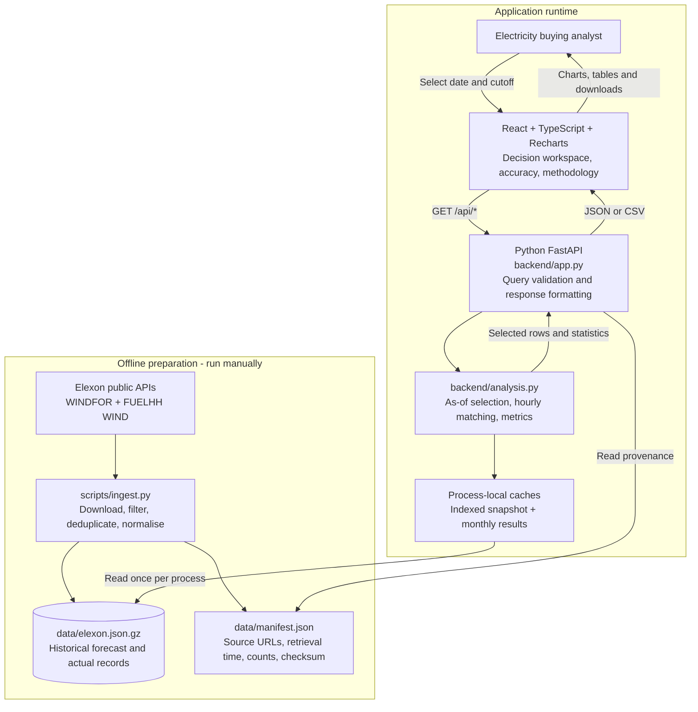
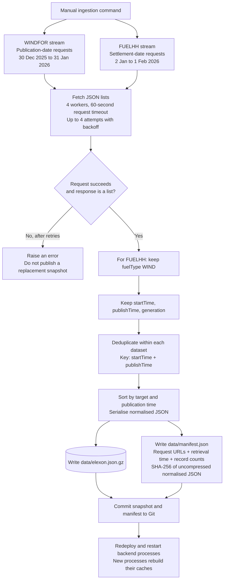
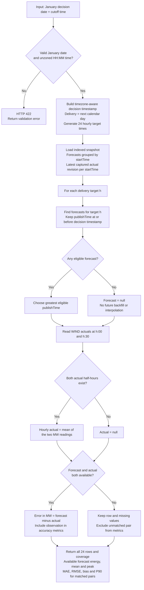
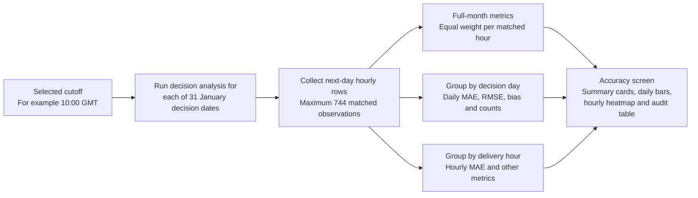
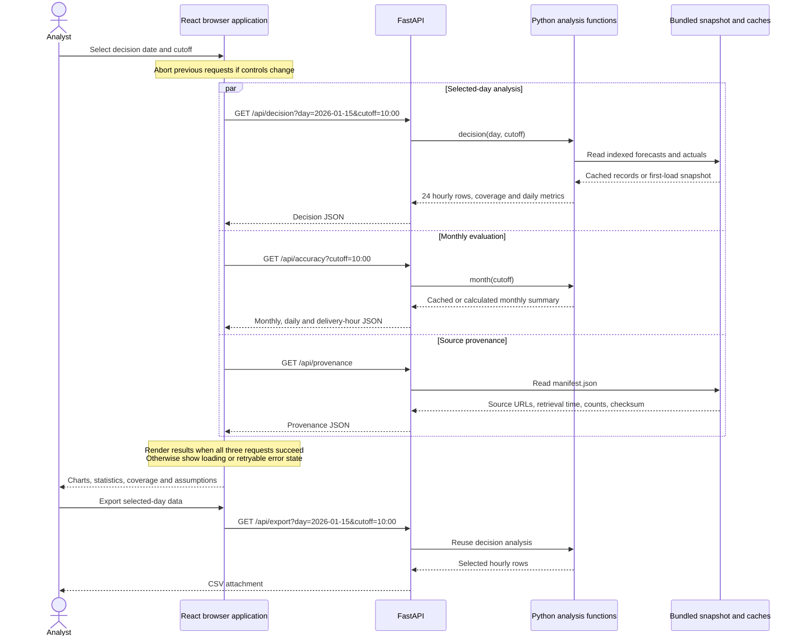
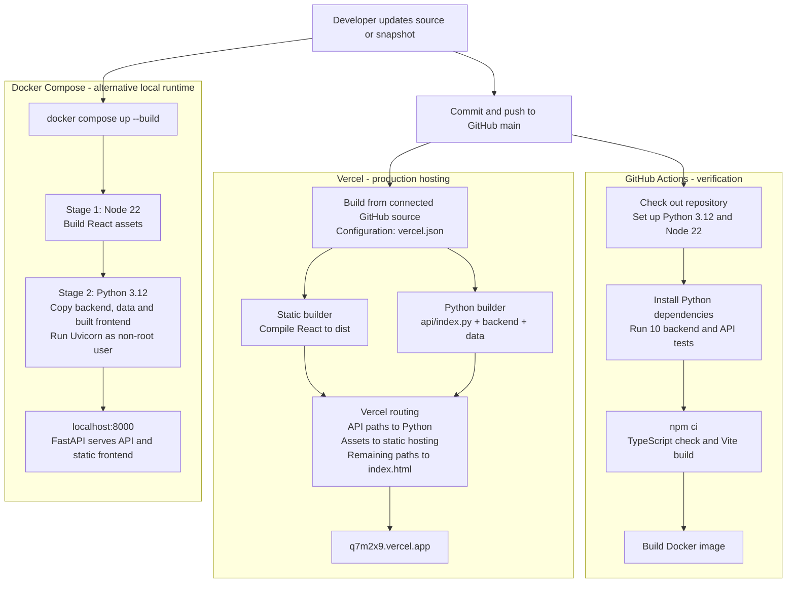

# Aeris · Wind intelligence

A decision-support pilot for a Great Britain electricity buying desk. Inspect the Elexon wind forecast **available at a chosen purchase-decision time**, and evaluate it against recorded generation. React + TypeScript frontend, Python FastAPI backend, Docker, and Vercel deployment.

## Links

- [Public GitHub repository](https://github.com/harshitdeora/q7m2x9)
- [Live application on Vercel](https://q7m2x9.vercel.app)
- Video: **not yet recorded or uploaded**. The assignment requires an unlisted YouTube video before submission. See `docs/demo-script.md` for a timed customer and technical walkthrough. Do not submit the assignment without the video.

## Product at a glance

| Screen | Question it answers |
|---|---|
| Decision workspace | What wind generation was forecast for tomorrow using only publications available at the selected purchase-decision time? |
| Forecast accuracy | How large were the historical forecast errors, in which direction, and on which days and delivery hours? |
| Data & methodology | Where did the data come from, how was it aligned, and which assumptions and limitations apply? |

**This is a historical analysis application.** Elexon supplies the predictions; the application selects and evaluates them. There is no new forecasting model, live daily refresh, or automatic electricity purchasing.

## System architecture

The application has two separate flows: an **offline data-preparation pipeline** and a **runtime analysis API**. Page requests read the committed snapshot; they do not call Elexon. The diagrams below render directly in GitHub's Markdown viewer.



| Layer | Responsibility | Implementation |
|---|---|---|
| Data preparation | Retrieve and normalise the two Elexon datasets | Python standard library, bounded concurrent HTTP requests |
| Storage | Preserve a reproducible historical input and its provenance | Compressed JSON and manifest committed to Git |
| Analysis | Select forecasts known at the cutoff, align actuals, calculate errors | Pure Python functions with process-local caching |
| API | Validate requests and return decision, accuracy, export and provenance results | FastAPI |
| Presentation | Let analysts explore dates, charts, tables and assumptions | React, TypeScript, Recharts, CSS design tokens |
| Delivery | Host the public sample and support portable local execution | Vercel; Docker as an alternative runtime |

There is no database, background scheduler, message queue, or external API key in the current design. Caches are held in memory and may be rebuilt on each serverless cold start. They are not persistent storage.

## Historical data pipeline

Run `python scripts/ingest.py` explicitly to rebuild the snapshot. The data download is separate from page loads and from the Vercel build.



The initial snapshot contains **19,272 forecast records** and **1,488 actual half-hours**. Forecast records include multiple revisions for a target time. Early publications support January 1 cutoffs; February 1 actuals support January 31 purchase decisions. An exhausted request failure stops ingestion before the output-writing stage; it does not create synthetic fallback data. The two output files are written sequentially, so snapshot replacement should be performed offline and reviewed before committing.

## Decision-time analysis pipeline

The central rule is to reconstruct the information available to a buyer **at the selected cutoff**, separately for each next-day delivery hour.



**Example:** for a decision on **15 January at 10:00 GMT**, delivery is **16 January**. For each delivery hour, the code chooses its most recent forecast published no later than 10:00. A 09:30 publication is eligible; a 10:30 publication is not. A publication exactly at 10:00 is eligible. Actuals are added afterward for retrospective verification, never treated as information known at that purchase decision.

The hourly forecast versus half-hour actual matching is an explicit pilot assumption, detailed in [Data and alignment](#data-and-alignment). An available forecast can contribute to forecast summaries even if its actual is missing; accuracy metrics require a matched pair. Zero generation is valid and is not treated as missing.

### Monthly accuracy aggregation



Monthly results are cached by cutoff, with a maximum of 48 cached summaries per process. The aggregate is calculated from individual observations, not an unweighted average of daily metrics. This entire full-month evaluation is **retrospective**; it is not a rolling error estimate available at every historical purchase decision.

## Browser-to-backend request flow



| Endpoint | Inputs | Output |
|---|---|---|
| `GET /api/decision` | `day`, `cutoff` | Selected next-day forecasts, actuals, publication times, coverage, energy and daily error metrics |
| `GET /api/accuracy` | `cutoff` | Whole-month metrics, per-decision-day results and per-delivery-hour results |
| `GET /api/export` | `day`, `cutoff` | Selected-day CSV with forecast, actual, error, publication time, age and actual-half-hour count |
| `GET /api/provenance` | None | Source manifest and checksum |
| `GET /api/health` | None | Basic service status; not a full data-integrity check |
| `GET /api/docs` | None | Interactive FastAPI documentation |

## Build and deployment pipeline

GitHub Actions verification and Vercel deployment are **separate processes triggered by a push**. The current configuration does not make Vercel wait for the GitHub Actions job to pass. Docker is an alternative local runtime, not the image deployed to Vercel.



The public application reads only public historical data and requires no runtime secrets. GitHub and Vercel authentication are used for publishing and deployment administration, not for retrieving the dataset while someone uses the app.

## Start the application

### Docker (one command)

Requires Docker Desktop with its Linux engine running, or Docker Engine with Compose.

```bash
docker compose up --build
```

Open http://localhost:8000. API documentation: http://localhost:8000/api/docs.

### Local development

Requires Node.js 22 and Python 3.12+.

```bash
python -m venv .venv
# Windows: .venv\Scripts\activate
# macOS/Linux: source .venv/bin/activate
pip install -r requirements.txt
uvicorn backend.app:app --reload --port 8000
```

In another terminal:

```bash
npm ci
npm run dev
```

Open the printed Vite URL (normally http://127.0.0.1:5173). Vite proxies `/api` to Python on port 8000. For a production build run `npm run build`; restart Uvicorn afterwards to serve the built frontend through Python.

## Scope and decision semantics

- Purchase decision dates: **1–31 January 2026**, inclusive. Delivery is the following calendar day: **2 January–1 February 2026**. The month boundary is intentional.
- Time zone: `Europe/London`, which is GMT / UTC+0 throughout this period. The default **10:00 GMT cutoff is an illustrative assumption**, not an asserted exchange deadline. Users can select other times.
- For every delivery target, choose the largest `publishTime <= decision timestamp`. This is a per-target as-of join, not simply the most recent publication in the dataset.
- No later forecast can fill a missing value. No future revisions, interpolation, or synthetic data are used.
- All actuals and monthly accuracy results are retrospective. They are never presented as estimates known at the original decision time.
- This is national context, not the client's contracted wind portfolio. No demand, prices, thermal generation data, contracts, trade execution, or purchase-volume optimisation is included.

## Data and alignment

Only the two requested Elexon datasets are used:

- [WINDFOR stream](https://bmrs.elexon.co.uk/api-documentation/endpoint/datasets/WINDFOR/stream): published wind forecasts.
- [FUELHH stream](https://bmrs.elexon.co.uk/api-documentation/endpoint/datasets/FUELHH/stream): actual generation, filtered to `fuelType=WIND`.

Although the brief describes matching target times, the **retrieved January WINDFOR records have hourly target timestamps**. FUELHH actuals have half-hourly targets. We explicitly align each hourly forecast at `h:00` to the mean of the actuals at `h:00` and `h:30`. Both actual half-hours must exist; otherwise the hour is excluded from metrics. No interpolated half-hour forecasts are invented. This treats the forecast as representative hourly power, a documented pilot assumption that should be confirmed with the client before operational use. Elexon describes its wind forecast and metered-wind coverage [here](https://bmrs.elexon.co.uk/wind-generation).

Forecast generation and actual generation are power in **MW**. The chart displays GW. Daily energy = sum of hourly forecast MW × 1 hour, divided by 1,000 for GWh. Partial coverage produces a partial total, accompanied by its coverage count. Actual revisions are resolved using the latest publication captured in the snapshot.

### Snapshot and reproducibility

The app uses `data/elexon.json.gz`, a checked-in snapshot of real public API responses (normalised to the three required fields), not a live feed. `data/manifest.json` contains retrieval time, source request URLs, record counts, and the SHA-256 hash of the uncompressed normalised JSON. The initial snapshot includes 19,272 forecast records and 1,488 WIND actual half-hours. Forecast publications from 30 December support early-January cutoffs. Historical actuals through 1 February support 31 January decisions.

Rebuild the snapshot with:

```bash
python scripts/ingest.py
```

The ingestion script uses four bounded concurrent requests, retries transient failures, deduplicates target/publication pairs, filters WIND, and fails rather than generating replacement data. Restart the backend after ingestion to clear its process-local caches. The public deployment does not automatically refresh data.

## Accuracy calculations

For matched hourly observations, `error = forecast − actual` in MW:

| Metric | Definition | Interpretation |
|---|---|---|
| MAE | mean(abs(error)) | Typical absolute miss |
| RMSE | sqrt(mean(error²)) | Penalises larger misses |
| Bias | mean(error) | Positive = wind overestimated |
| P90 absolute error | Nearest-rank 90th percentile of abs(error) | Historical tail descriptor, not a prediction interval |

Nulls are excluded; zero is a valid value. The monthly aggregate weights every matched observation equally. Counts and expected coverage are displayed. No MAPE is used because near-zero wind makes percentage errors unstable.

At the default 10:00 cutoff, the initial snapshot has 744/744 matched hourly observations across the 31 decisions. Full-month MAE is approximately 2,013 MW and bias +1,730 MW. These are retrospective pilot statistics under the alignment assumption above, not a guaranteed future error or an operational reserve recommendation.

## Repository structure

```text
q7m2x9/
├── src/                     React screens, typed contracts and styling
├── public/                  Favicon and public assets
├── backend/
│   ├── analysis.py          Snapshot loading, as-of selection and metrics
│   └── app.py               FastAPI routes and local static serving
├── api/index.py             Vercel Python entrypoint
├── data/
│   ├── elexon.json.gz       Normalised historical records
│   └── manifest.json        Source provenance and checksum
├── scripts/ingest.py        Manual snapshot preparation
├── tests/test_analysis.py   Backend, data-contract and API verification
├── .github/workflows/       Automated checks
├── docs/                    Handover, demo script and submission checks
├── Dockerfile               Two-stage frontend and backend build
├── compose.yaml             Local container runtime and health check
├── vercel.json              Static and Python hosting configuration
├── package.json             Frontend dependencies and commands
├── package-lock.json        Locked frontend dependency versions
├── requirements.txt         Direct Python dependencies
├── vite.config.ts           Frontend build and development API proxy
└── README.md                Product, design, pipeline and startup guide
```

| Path | Purpose |
|---|---|
| `src/main.tsx` | Responsive decision workspace, accuracy analysis, methodology, CSV download |
| `src/styles.css` | Visual system, charts, desktop/mobile layouts and focus states |
| `src/types.ts` | Typed API response contracts |
| `public/` | App favicon |
| `backend/analysis.py` | Pure as-of selection, hourly matching, metrics, process-local caching |
| `backend/app.py` | Validated API endpoints, CSV export and local production static serving |
| `api/index.py` | Vercel Python function entrypoint |
| `data/` | Reproducible compressed snapshot and provenance manifest |
| `scripts/ingest.py` | Download and normalise the public Elexon data |
| `tests/test_analysis.py` | Algorithm, boundaries, data integrity and API tests |
| `.github/workflows/checks.yml` | Automated backend tests, frontend build and Docker build |
| `docs/` | Technical handover, demo script and submission checklist |
| `Dockerfile`, `compose.yaml` | Two-stage frontend/Python container and local startup |
| `vercel.json` | Static React build and Python function routing on Vercel |
| `package-lock.json`, `requirements.txt` | Frontend lockfile and pinned direct Python dependencies |

API endpoints: `/api/decision?day=2026-01-15&cutoff=10:00`, `/api/accuracy?cutoff=10:00`, `/api/export`, `/api/provenance`, `/api/health`, `/api/docs`. Invalid dates and times return HTTP 422. There is no authentication because the pilot exposes only public historical data. No credentials are required at runtime.

## Verification

```bash
python -m unittest discover -s tests -v
npm run build
docker build -t aeris .
```

Tests cover the inclusive decision cutoff, rejection of later forecasts, missing actuals, zero values, metric definitions, January/February boundary, provenance checksum, full-snapshot leakage checks, weighted monthly aggregation, validation, and CSV export. GitHub Actions repeats tests/builds and builds the container. See `docs/verification.md` for checks actually performed and any remaining limits.

## Deploy on Vercel

Import this repository into Vercel from the repository root. `vercel.json` builds the React static files with `@vercel/static-build` and exposes FastAPI with `@vercel/python`. `/api/*` is routed to Python; remaining paths use the React frontend. Keep project build overrides empty so the committed configuration is authoritative. No environment variables or paid integrations are needed. Vercel builds source directly; Docker remains the portable alternative.

The existing production project `hunter-527a/q7m2x9` is connected to this GitHub repository. Pushes to `main` trigger Vercel deployments. The initial release was deployed using the authenticated Vercel CLI and verified through unauthenticated HTTP requests.

## AI disclosure

**OpenAI Codex was used to assist with domain research, product design, implementation, documentation, testing, and deployment preparation.** Forecasts are supplied by Elexon; this app does not use AI to generate electricity forecasts or trading recommendations. Review the data assumptions and code before operational use.

## Pilot limitations

This bounded version prioritises a reviewable product within the assignment's 16-hour budget. It uses a fixed historical snapshot and process-local caches, with no database, live refresh, automatic bidding, or uncertainty model. A production version would need agreed gate times, source semantics validated with the client, portfolio/demand data, monitored ingestion, persistent storage, broader time coverage, and decision-time historical error estimates. No claimed financial savings have been inferred from these two datasets.
